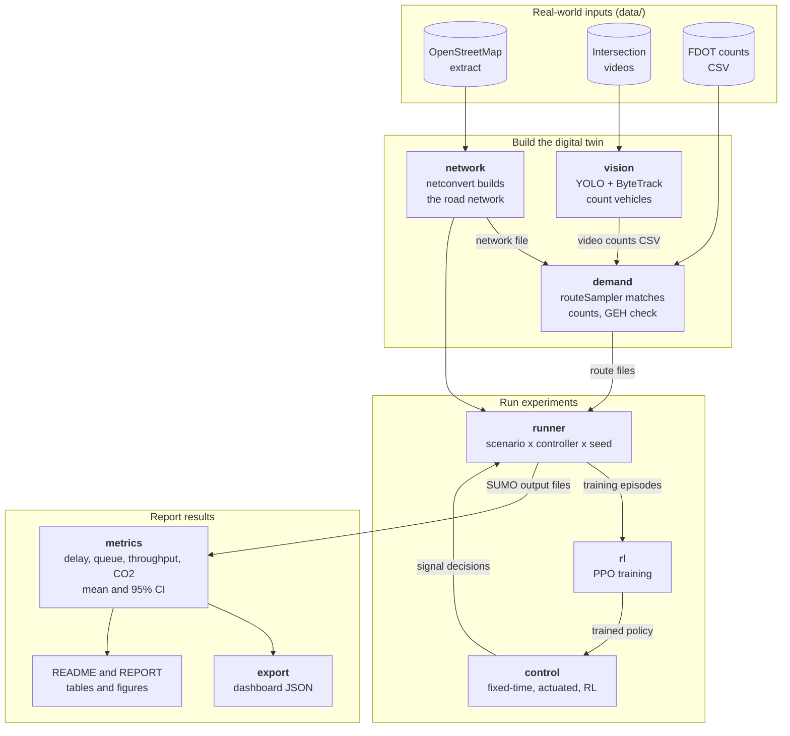
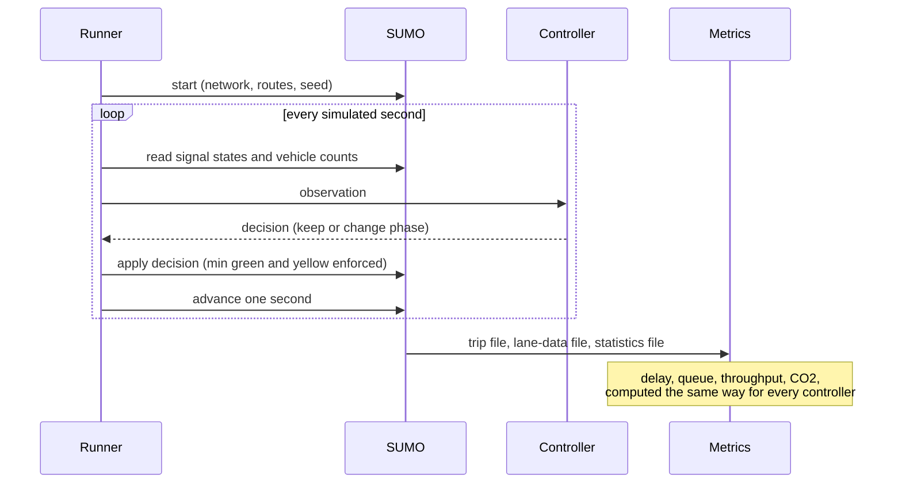
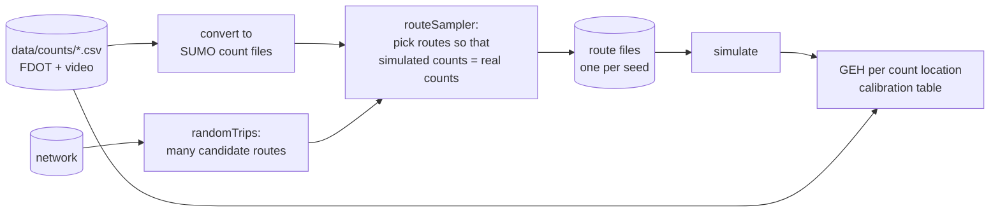

# OmniFlow Real — Design Document

**Status:** draft, waiting for approval (milestone M0) · **Last updated:** 2026-11-11

This document is the plan for the whole project. Nothing after M0 gets built
until you approve it. Sections 1–3 are the big picture, sections 4–10 are the
plan for each stage, section 11 covers reproducibility and testing, section 12
lists what can go wrong, and **section 13 lists what I need from you**.
Technical words are explained in the glossary (section 14).

Three labels show how solid each statement is:

| Label | Meaning |
|-------|---------|
| **[verified]** | I ran or checked this myself during M0, in this repository's environment. Where a test in `tests/` repeats the check, the test is named. Otherwise it was a one-off check. |
| **[planned]** | A design decision. It gets implemented, and confirmed or revised, in the milestone named next to it. |
| **[check]** | A real-world fact from an outside source that I could not open directly. You should confirm it. |

---

## 1. Goal and scope

### 1.1 The research question

> In a simulation of downtown DeLand that is calibrated with real traffic
> counts, does multi-agent reinforcement learning (RL) control the traffic
> signals better than well-tuned fixed-time and actuated control? And how do
> the three behave when something goes wrong: a crash that closes a lane, a
> large Stetson event, an emergency vehicle?

"Better" means, first, **lower average delay per vehicle**. Queue length,
throughput and CO2 are secondary. The answer is allowed to be "no". If RL does
not beat the baselines, the report says so and explains why. A fair "no" is a
real result; an unfair "yes" is worth nothing.

### 1.2 What gets delivered

1. A **digital twin**: a SUMO road network of downtown DeLand built from
   OpenStreetMap, with traffic demand calibrated against real counts.
2. Three **signal controllers** that can be swapped in and out: fixed-time,
   actuated, and multi-agent RL (PPO with one shared policy).
3. An **evaluation pipeline** that runs every controller on exactly the same
   scenarios and seeds and reports mean and 95% confidence interval.
4. A **vision tool** that turns your intersection videos into traffic counts.
5. A **research-style report**, a reproducible README, and a JSON export for
   your OmniFlow web dashboard.

### 1.3 What this project does not do

- It does not control real traffic signals. Everything happens in simulation.
- The first version does not simulate pedestrians, cyclists, buses, or cars
  parking on the street. Downtown DeLand has many pedestrians, so this is a
  real limitation, and the report will say so.
- It does not claim absolute CO2 numbers. The emission model is European
  (section 8.5), so only comparisons between controllers are meaningful.
- It does not claim to beat the system that runs on Woodland Blvd today
  (section 6.5 explains why this matters).

---

## 2. Architecture

The project is a **pipeline**: each stage reads files and writes files.



### 2.1 The stages

| Stage | Code | What it does | Milestone |
|-------|------|--------------|-----------|
| network | `src/omniflow/network/` | Download the OpenStreetMap extract, run `netconvert`, list and map the signals | M1 |
| demand | `src/omniflow/demand/` | Generate traffic, calibrate it against counts, report GEH | M2 |
| control | `src/omniflow/control/` | Fixed-time, actuated and RL controllers behind one interface | M3, M4 |
| metrics | `src/omniflow/metrics/` | Delay, queue, throughput, CO2, confidence intervals | M3 |
| rl | `src/omniflow/rl/` | Learning environment, training, evaluation | M4 |
| vision | `src/omniflow/vision/` | Vehicle counts from video | M6 |
| export | `src/omniflow/export/` | JSON for the dashboard | M7 |

Three small modules are shared by all stages and live next to them:

| Module | Purpose | Status |
|--------|---------|--------|
| `sumo_tools.py` | Find the pinned SUMO programs; choose how Python talks to SUMO | **[verified]** built in M0 |
| `runner.py` | Run one simulation for a (scenario, controller, seed) | **[planned]** M3 |
| `config.py` | The experiment constants (seeds, durations) in exactly one place | **[planned]** M3 |

### 2.2 Five design principles

1. **A pipeline of files.** Stages talk to each other only through files on
   disk. You can rerun one stage alone, open any intermediate file in
   `sumo-gui`, and test each stage separately.
2. **One runner for every controller.** There is a single piece of code that
   starts SUMO and steps it. The controller is a plug-in. So the scenario, the
   seed and the simulation length cannot differ between controllers by
   accident.
3. **The simulator grades everyone.** All metrics are computed from SUMO's own
   output files, by one metrics module. A controller never measures itself. In
   particular, the RL reward is *not* the evaluation metric.
4. **Placeholders are loud.** Real data and placeholder data never mix
   silently. Every placeholder row is flagged, and the flag travels all the way
   into the tables and the report.
5. **Everything is seeded.** Every random choice comes from a seed that is
   written down, so every number can be regenerated.

### 2.3 One simulation run, step by step



For fixed-time and actuated control, SUMO runs the signal program itself, so
the controller's "decision" is "do nothing". They still go through the same
loop and write the same output files.

**[verified]** in M0 on a toy intersection: Python can read the simulation
state every second and command the traffic light; the same seed gives exactly
the same result; and the two ways Python can talk to SUMO (`libsumo` and
`traci`) give exactly the same result. Run `scripts/m0_smoke_test.py` to see
it.

---

## 3. Data flow: which file comes from where

| Artifact | Path | Written by | In git? |
|----------|------|-----------|---------|
| OpenStreetMap extract (frozen snapshot) | `data/osm/` | M1 script | yes |
| Count data: FDOT and video counts | `data/counts/*.csv` | you, and the M6 vision tool | yes |
| Intersection videos | `data/videos/` | you | **no** (large; faces and licence plates) |
| SUMO network | `network/` | M1 script | yes |
| Signal inventory (table and PNG map) | `network/`, `results/` | M1 script | yes |
| Route files (traffic demand) per scenario and seed | `network/demand/` | M2 script | evaluation files: yes |
| Signal programs for the baselines | `network/tls/` | M3 script | yes |
| Raw simulator output, training logs | `results/raw/` | runner | **no** (large, regenerable) |
| Result tables (CSV) and figures (PNG) | `results/` | metrics | yes |
| Final trained policy | `results/models/` | M4 training | yes (small) |
| Dashboard JSON | `results/dashboard/` | export | yes |

Two rules follow from this table:

- **Evaluation inputs are frozen files in git.** The network and the route
  files used for the final results are committed. The main results table can
  then be reproduced from a fresh clone without redoing the calibration.
- **Every results table carries its provenance**: git commit, SUMO version,
  seeds and settings are written next to it (section 11).

Proposal: all generated SUMO input files go under `network/` (your structure
calls it "generated SUMO network files"). Tell me if you would rather have a
separate `scenarios/` folder.

---

## 4. Network (M1) **[planned]**

### 4.1 Study area

The Woodland Blvd (US 17-92) corridor from the Stetson University campus south
through downtown, the New York Ave (SR 44) crossing, and the parallel and
cross streets one or two blocks to each side, so that turning traffic and
detours have somewhere to go. The exact bounding box is fixed in M1, on a map
that you approve.

Two facts found during M0 research that the network must get right:

- **[check]** A Florida DOT project page (project 439881-5, found through a web
  search) lists signalized intersections on Woodland Blvd at Voorhis, Howry,
  New York (SR 44), Indiana, Rich, Wisconsin, Pennsylvania, Minnesota and
  Plymouth Avenues, and at International Speedway Blvd. M1 will compare the
  signals found in OpenStreetMap against this list, and you confirm on the
  street.
- **[check]** AARoads reports that turns are prohibited in all directions at
  Woodland Blvd and New York Ave. You can confirm this in five minutes on foot.
  It matters: turn bans change both the signal phases and the routes drivers
  take.

### 4.2 Steps

1. **Download** the OpenStreetMap extract for the bounding box and commit it
   with its download date. OpenStreetMap changes every day; a frozen snapshot
   keeps the project reproducible.
2. **Convert** with `netconvert`. Starting point is the option set from SUMO's
   OpenStreetMap import guide. Every option gets a one-line reason in M1.
   The important ones (all **[verified]** to exist in SUMO 1.28):

   | Option | Why |
   |--------|-----|
   | `--keep-edges.by-vclass passenger`, `--remove-edges.isolated` | Keep only the network that cars can drive on |
   | `--geometry.remove` | Merge road pieces that OpenStreetMap splits only to draw curves |
   | `--junctions.join` | OpenStreetMap draws one big intersection as several points; join them |
   | `--tls.guess-signals`, `--tls.join`, `--tls.discard-simple` | Find the signals and make one controller per real intersection |
   | `--osm.turn-lanes` | Use turn-lane markings where OpenStreetMap has them |
   | `--output.street-names`, `--output.original-names` | Keep street names and OpenStreetMap IDs so every edge can be traced back |

3. **Inventory**: a table of every signalized intersection (ID, cross streets,
   coordinates, number of approaches and phases) and a PNG map with the signals
   marked.
4. **Verify by eye**: you check the map against reality with a checklist:
   signal present? number of lanes? turn lanes? one-way streets? turn bans?
   speed limits?
5. **Fix by patch, never by hand.** Corrections are written as small
   `netconvert` patch files that the build script applies. A manual edit in a
   GUI would be lost the next time the network is rebuilt.

**Done when:** the network loads in SUMO with no errors and you can see the
list and the map of signalized intersections.

**Environment note [verified]:** the Claude cloud session that wrote this
cannot reach the OpenStreetMap download servers (the hosts are not on the
session's network allow-list). Section 13 gives the two ways around this.

---

## 5. Demand and calibration (M2) **[planned]**

### 5.1 Stage A: synthetic demand

First, random but plausible traffic to get everything running: SUMO's
`randomTrips.py`, set up so most trips start and end at the edge of the map
(through traffic). Every output of this stage is labelled **synthetic**.

### 5.2 Stage B: calibration against counts

*Calibration* means adjusting the simulated traffic until the simulation
counts the same number of vehicles as the real world did, at the same places.



- **Two kinds of counts.** A *link count* is the number of vehicles passing a
  point on a road (what an FDOT count station gives). A *turning-movement
  count* is the number of vehicles making one specific movement at an
  intersection, for example "from the north, turning left" (what your videos
  give).
- **Tool.** SUMO's `routeSampler.py` chooses routes from a large candidate set
  so that simulated counts match measured counts in every time interval.
  **[verified]** in SUMO 1.28 (from its option list; not yet run): it accepts
  link counts and turn counts, takes a seed, and has options for a mismatch
  report and a GEH threshold.
- **From daily to hourly counts.** FDOT publishes AADT (average vehicles per
  day) together with a K factor (the share of daily traffic in the peak hour)
  and a D factor (the share travelling in the peak direction). Peak-hour,
  peak-direction volume is approximately AADT × K × D. This is an estimate, not
  a measurement, so such rows are marked `derived from AADT` in the CSV. Counts
  taken during the modelled hour are better.

### 5.3 The calibration score: GEH

For each count location, with *M* the simulated volume and *C* the counted
volume, both in vehicles per hour:

$$\mathrm{GEH} = \sqrt{\frac{2\,(M - C)^2}{M + C}}$$

GEH is used instead of percent error because percent error is unfair in both
directions: 10 versus 15 vehicles is a "50% error" that nobody cares about
(GEH 1.4), while 2000 versus 2400 is "only 20%" but is a serious miss
(GEH 8.5). GEH tolerates small absolute errors on small flows and demands more
on big flows.

Target **[planned]**: GEH below 5 at 85% or more of the count locations. This
is a widely used rule of thumb; it comes from UK guidance and appears in US
state DOT manuals. In M2 we look up what the current FDOT Traffic Analysis
Handbook asks for and use that if it differs **[check]**.

### 5.4 Being honest about calibration

- **In-sample versus hold-out.** Matching the counts you calibrated on is the
  easy part. If there are enough count locations, about one in five is kept
  out of the calibration and used only to check it. If there are too few, the
  report says that the calibration could not be validated independently.
- **Counts do not pin down trips.** Counts say how many cars pass a point, not
  where they come from or go to. Many different trip patterns fit the same
  counts. The report states this.
- **Placeholders.** A count that has not been collected yet is a row with
  `is_placeholder = true`. The calibration table shows the flag, and any
  README or report built from placeholder data prints a warning banner. A test
  makes sure the banner cannot be dropped.

**Done when:** a one-hour peak scenario runs and a calibration table exists,
with placeholders clearly marked.

---

## 6. Controllers (M3, M4) **[planned]**

### 6.1 The same rules for everyone

A comparison is only fair if the controllers differ in **one** thing: *when
they decide to end a green phase*. Everything else is held equal.

| Rule | Same for all controllers? |
|------|---------------------------|
| Phases (which movements get green together) and their order | yes, taken from the network's signal program |
| Yellow time | yes, from the approach speed (FDOT table or ITE formula, looked up in M3) |
| All-red clearance time | yes (see the sumo-rl note in section 6.4) |
| Minimum green | yes |
| Maximum green | yes, for actuated and RL |
| What each controller can sense | stated explicitly per controller, at the same distance from the stop line |
| Scenario, seed, simulation length, metric code | yes, enforced by the single runner |

### 6.2 Fixed-time: a realistic plan

A fixed-time signal repeats the same cycle regardless of traffic. "Realistic"
means it is designed the way a traffic engineer would, not left on SUMO's
defaults:

- **Cycle length and green split per intersection: Webster's method.** Each
  phase *i* has a *critical flow ratio* *y*: the demand on the busiest lane it
  serves, divided by that lane's saturation flow (the flow it could carry if
  it had green all the time). *Y* is the sum of *y* over all phases, and *L* is
  the time lost per cycle in yellow and all-red, in seconds. Webster's cycle
  length *C* and the green time *g* of phase *i* are:

$$C = \frac{1.5\,L + 5}{1 - Y} \qquad\qquad g_i = (C - L)\,\frac{y_i}{Y}$$

- **Coordination along Woodland Blvd.** The corridor signals share one cycle
  length, and each signal starts its green a little later than its upstream
  neighbour (the *offset* is the travel time between them), so a platoon of
  cars meets a "green wave".
- We write Webster's formula ourselves as a small tested function and
  cross-check against SUMO's own tools (`tlsCycleAdaptation.py`,
  `tlsCoordinator.py`, **[verified]** present in the pinned SUMO).
- The plan is tuned on the calibrated demand using the validation seeds
  (section 9.1) and then frozen.

If you obtain the real signal timing sheets (section 13), the real plan is
added as one more controller.

### 6.3 Actuated

An actuated signal has detectors. Each phase has a minimum and a maximum
green. The green is extended while vehicles keep arriving close together and
ends when a gap appears or the maximum is reached. We use SUMO's built-in
gap-based actuated control, with the same minimum and maximum greens as RL.

US field controllers follow the NEMA dual-ring standard. SUMO 1.28 has a NEMA
controller type (**[verified]** in its schema). Using it is a stretch goal,
mainly worthwhile if real timing sheets are available.

### 6.4 Reinforcement learning

Section 7.

Compatibility findings **[verified]** during M0:

- `sumo-rl` 1.4.5 is the latest release on PyPI (May 2024). Its PettingZoo
  wrapper **crashes** with the current PettingZoo (1.27.0), because a class it
  imports was renamed. Its core environment class works with current Gymnasium
  (1.4.0) and SUMO (1.28.0), both through `traci` and through `libsumo`.
- Reading its source: it has no all-red phases, it accepts a `max_green`
  setting but never enforces it, it uses one yellow time for every signal, and
  it measures vehicles over a whole lane.
- A throwaway experiment (not kept in the repo) trained a shared PPO policy
  with Stable-Baselines3 on sumo-rl's bundled 2×2 grid, on CPU, end to end. So
  the planned stack works together.

Decision: use sumo-rl's core, but only behind our own adapter module
(`omniflow.rl.env`), which adds the missing rules (maximum green, the shared
clearance times). Nothing else in the project imports sumo-rl. If the
workarounds get ugly, we replace its signal class with our own (about 200
lines) and nothing else changes.

### 6.5 What runs on Woodland Blvd today

**[check]** A Florida DOT project page (project 437842-1, found through a web
search, status listed as completed) describes a "Traffic Adaptive Signal
Control System on U.S. 17-92 from Monroe Road in Seminole County to Minnesota
Avenue in Volusia County". If that is right, the signals in our study area may
already run a commercial adaptive system, which is more advanced than
fixed-time or simple actuated control.

Consequences:

1. The report must never say "RL beats what DeLand has today". Our baselines
   are standard textbook baselines, not the field system. The field system's
   algorithm is proprietary and cannot be reproduced here.
2. It is worth asking Volusia County Traffic Engineering what actually runs
   there (section 13).
3. It strengthens the case for the optional baseline below.

### 6.6 Optional extra baseline: max-pressure

Max-pressure is a simple adaptive rule: give green to the phase with the
largest difference between waiting vehicles upstream and space downstream. It
needs no training, has theoretical backing (Varaiya 2013), and is a standard
strong baseline in the RL traffic-signal literature. RL papers are often
criticised for weak baselines; this is cheap protection against that. I
recommend adding it in M3. Your call (section 13).

---

## 7. Reinforcement learning formulation (M4) **[planned]**

This is the plan. M4 implements it and writes the full justification, and may
revise it based on evidence.

### 7.1 Agents and parameter sharing

Each signalized intersection is one agent. All agents share **one** neural
network (*parameter sharing*): every intersection's experience trains the
same policy. This learns faster on a laptop (many agents feed one network),
and one policy can, in principle, be applied to an intersection it has never
seen.

The catch, and the main design constraint: a shared network needs every agent
to see inputs of the **same size and the same meaning**, and to choose from
the **same actions**, although real intersections have different numbers of
lanes and phases.

### 7.2 Action: keep or switch

Every 5 seconds, each agent chooses one of two actions:

- **keep** the current green phase, or
- **switch** to the next phase in the fixed order (a yellow, then the next
  green).

A switch is ignored until the minimum green has passed, and forced when the
maximum green is reached.

Why this and not "pick any phase": two actions mean the same thing at every
intersection, so parameter sharing works without tricks. It also matches the
baselines exactly: fixed-time and actuated control also run the phases in
order and differ only in when each phase ends. The cost is that RL cannot skip
a phase. "Pick any phase" (with masking for phases that do not exist) is an
ablation for M4 if time allows.

### 7.3 Observation: described relative to the current phase

A fixed-length vector, built so that each number means the same thing at every
intersection:

- queue and vehicle density on the lanes served by the **current** phase,
- the same for the **next** phase,
- the same for all **other** phases combined,
- how long the current green has lasted (as a fraction of the maximum green),
  and whether the minimum green has passed,
- how full the downstream lanes are (so the agent can avoid feeding a blocked
  road).

All values are scaled to lie between 0 and 1. Sensing assumption: vehicles are
detected on the incoming lanes up to a fixed distance from the stop line,
which is what a camera at the intersection could provide. M6 builds exactly
that kind of camera counting, on video.

### 7.4 Reward

```
reward of agent i  =  - (number of vehicles standing still on agent i's incoming lanes)
```

summed over the 5-second step and scaled. Reason: one stopped vehicle for one
second is one vehicle-second of delay, so the sum of this reward over an
episode is (minus) the total stopped delay at that intersection. The reward
points at the metric we report.

Known weakness: the reward is local. An agent could clear its own queue by
pushing cars into its neighbour's. The downstream-occupancy input is meant to
counter that, and M4 compares against a pressure-based reward as an ablation.

Note that sumo-rl's default reward (the change in accumulated waiting time
from one step to the next) is not used. When you add those changes up over an
episode, all the middle terms cancel and only the first and the last moment
remain, so the episode total says almost nothing about how good the episode
was.

### 7.5 Algorithm and training

- **PPO** from Stable-Baselines3, one shared policy, a small two-layer
  network, CPU only.
- **Fast simulation.** Training uses `libsumo`, which runs SUMO inside the
  Python process instead of over a network socket. **[verified]** on the toy
  intersection: same results, much faster.
- **Fixed budget.** The training budget (number of steps) is fixed before
  training starts and written in the report, together with the number of
  hyperparameter settings that were tried. Otherwise one can always "win" by
  tuning RL longer than the baselines.
- **More than one training run.** RL results depend on the training seed. If
  the laptop budget allows, three independent training runs are reported, not
  only the best one.
- **Model selection on validation seeds only** (section 9.1). The test seeds
  are used once, at the end.

---

## 8. Metrics (M3) **[planned]**

All metrics are computed from files SUMO writes itself. The attribute names
below are **[verified]** in SUMO 1.28 output.

### 8.1 Who gets measured: the cohort

A run has three parts: a **warm-up** (the empty network fills up; not
measured), the **analysis hour**, and a **cool-down** (traffic keeps flowing so
that vehicles from the analysis hour can finish their trips under normal
conditions).

The **cohort** is every vehicle whose *scheduled* departure time falls inside
the analysis hour. The schedule comes from the route file, not from the
controller. So **the measured set of vehicles is identical for every
controller**. **[verified]** on the toy intersection by the test
`test_same_seed_means_same_vehicles_whatever_the_signal_does`: with the same
seed and two very different signal controls, every vehicle that enters has the
same scheduled departure time and the same speed factor (its personal
preferred speed) in both runs.

### 8.2 Average delay per vehicle (primary metric)

For each cohort vehicle *i*:

$$d_i = \mathrm{timeLoss}_i + \mathrm{departDelay}_i$$

The reported delay is the average of *d* over all cohort vehicles, in seconds
per vehicle.

- `timeLoss` is the time lost by driving slower than the vehicle's free-flow
  speed (waiting at signals, crawling in queues).
- `departDelay` is the time the vehicle had to wait *outside* the network
  because the road where it wanted to enter was full.

**Why `departDelay` must be included [verified].** In the M0 smoke test, one
run holds the signal green for north–south only. East–west traffic backs up to
the edge of the map, and after that, new east–west vehicles cannot even enter.
SUMO's trip report has no record at all for a vehicle that never entered (test
`test_vehicles_that_never_entered_are_missing_from_sumos_trip_report`), so an
average taken over that report silently leaves the worst-off vehicles out. A
controller that jams the network would look *better* than it is. Our
definition closes that hole:

| Vehicle status at the end of the run | Delay counted | Flag |
|--------------------------------------|---------------|------|
| finished its trip | `timeLoss + departDelay` | — |
| entered but not finished | `timeLoss` so far `+ departDelay` (a lower bound) | *unfinished* |
| never entered | end of run minus scheduled departure (a lower bound) | *not inserted* |

Every results table shows the percentage of *unfinished* and *not inserted*
vehicles next to the delay. If that percentage is not small, the delay is only
a lower bound and the table says so.

### 8.3 Average queue length

The number of vehicles standing still (slower than 0.1 m/s) on a lane leading
into a signal, averaged over the analysis hour and over all such lanes. It is
computed from SUMO's lane-data output: total standing time on the lane divided
by the length of the hour.

**[verified]** in a one-off check on the toy intersection: this agrees
closely, but not exactly, with counting standing vehicles once per second from
Python. I have not yet pinned down where the small difference comes from; M3
investigates it and records it in a test. Either way, one definition (the
lane-data one) is used for every controller.

### 8.4 Throughput

The number of vehicles that complete their trip during the analysis hour, in
vehicles per hour. When the network copes with the demand, throughput simply
equals demand and tells you little. It becomes the key number when a
controller cannot cope.

### 8.5 CO2

Total CO2 emitted by the cohort divided by the number of cohort vehicles
(grams per vehicle), from SUMO's emission model with emission output switched
on for every vehicle.

Limitations: **[verified]** the default emission class in SUMO 1.28 is
`HBEFA4/PC_petrol_Euro-4`, a European petrol car. The Florida fleet is
different, so absolute values are not valid for DeLand. Differences *between
controllers* on the same traffic are still informative, because stop-and-go
driving raises emissions under any model.

### 8.6 Health checks reported with every run

From SUMO's statistics file (**[verified]** attributes): number of
**teleports** (SUMO removes a vehicle that has been stuck for 300 seconds and
puts it further along its route; many teleports mean the run is not
trustworthy), **collisions** and **emergency braking** events (should be zero;
a non-zero value points to bad yellow times or a bug in a controller).

---

## 9. Experiment protocol **[planned]**

### 9.1 Three sets of seeds

| Set | Proposed seeds | Used for | Rule |
|-----|----------------|----------|------|
| Training | 1000 and up | RL training episodes | never used for reporting |
| Validation | 100–104 | tuning the baselines, RL hyperparameters, choosing the RL checkpoint | never used for the final table |
| Test | 0–9 | the final results tables | used once, at the end |

A seed fixes both the traffic of that "day" (which vehicles depart when, on
which routes) and the driver randomness inside SUMO. Different seeds are
different days drawn from the same calibrated demand.

Why three sets: if you pick the model that looks best on the days you report,
you report luck. The baselines are tuned on the same validation seeds with a
comparable, documented effort.

Ten test seeds are proposed; the brief's minimum is five. With five seeds the
confidence interval multiplier is 2.78, with ten it is 2.26, and the estimate
of the spread is far more reliable.

### 9.2 The grid

Every controller runs on every scenario with every test seed:

```
scenarios  x  controllers  x  test seeds
(peak, incident, event, emergency)  x  (fixed-time, actuated, RL, [max-pressure])  x  (0..9)
```

Same network file, same route file per (scenario, seed), same simulation
length (proposed: 15 min warm-up + 60 min analysis + 15 min cool-down), same
metric code. No run is dropped. If a run fails, it is reported as failed.

### 9.3 Statistics

For one controller and one metric there is one value per seed: *n* values
with mean *x̄* and sample standard deviation *s*. The 95% confidence interval
is

$$\bar{x} \pm t_{0.975,\,n-1} \cdot \frac{s}{\sqrt{n}}$$

where the multiplier *t* comes from Student's t-distribution and grows when
there are fewer seeds.

**Comparing two controllers uses paired differences.** Controllers A and B ran
on the same seeds. So for each seed we take the difference "A's value minus
B's value" and build the confidence interval of the mean of those differences.
This removes the "seed 3 was simply a heavy-traffic day" noise that both
controllers share, which makes the comparison much sharper. The report claims
"A is better than B" only if this interval excludes zero. Per-seed values are
published, so anyone can recompute.

### 9.4 Stress scenarios (M5)

| Scenario | What changes | What it tests |
|----------|--------------|---------------|
| `peak` | Nothing: the calibrated peak hour | Normal operation |
| `incident` | A lane (or one direction) of Woodland Blvd is closed for part of the hour | Reaction to lost capacity |
| `event` | Extra trips to and from the campus area (for example commencement) | Reaction to a demand surge |
| `emergency` | Emergency vehicles drive through the corridor | Priority handling |

- The disturbance is part of the **scenario files**, never of the controller,
  so all controllers face the identical disturbance.
- **No re-tuning.** All controllers are designed or trained on normal traffic
  (RL with moderately randomised demand) and then face the stress scenarios
  unchanged. That is the realistic situation, and it treats everyone equally.
- Emergency priority is implemented once, as a shared layer that any
  controller can run under. Results are shown with and without it.
- The size of the event surge needs a number from you (section 13). Until
  then it is a flagged placeholder.

---

## 10. Vision counting (M6) and dashboard export (M7) **[planned]**

### 10.1 Vision

```
video -> YOLO detects vehicles in each frame
      -> ByteTrack links detections into one track per vehicle
      -> a track that crosses entry line A and then exit line B is one "A to B" movement
      -> movements are summed per 15 minutes
      -> CSV in the same format as data/counts/ (M2)
```

- Counting lines are defined per video in a small file (two points per line).
- **Accuracy check.** You count a 10–15 minute stretch by hand using a tally
  sheet. A script compares the hand count with the automatic count per
  movement. The accuracy stated in the README comes from that script.
- Running on a laptop CPU: a small YOLO model, with frames skipped if needed.
- **Licence [verified].** The `ultralytics` package is AGPL-3.0, a strong
  copyleft licence; this repository is MIT. Vision is therefore an optional
  install, isolated in `omniflow.vision`, and nothing else depends on it. That
  is fine for an open research repository, but it would need attention before
  any commercial use. (This is a flag, not legal advice.)

### 10.2 Dashboard export

A versioned JSON file (`schema_version` field) holding: provenance, the
intersections with coordinates, scenarios, controllers, and for every metric
the mean, the confidence interval, the number of seeds and the per-seed
values. The format is documented by a JSON Schema file, and a test validates
every export against it.

Open point: I do not know what your existing dashboard expects. I need a
sample of the JSON it loads today, or access to its code (section 13). No
dashboard repository is visible from this session.

---

## 11. Reproducibility and testing

### 11.1 Reproducibility

| Mechanism | Status |
|-----------|--------|
| SUMO pinned to exactly 1.28.0 (simulator, `sumolib`, `traci`, `libsumo`) | **[verified]** M0 |
| Every other package pinned by `uv.lock`, for Linux, macOS and Windows | **[verified]** M0 |
| Code always uses the pinned SUMO, even if another SUMO is installed on the machine | **[verified]** M0, tested |
| Same seed gives exactly the same simulation | **[verified]** M0, tested on the toy network |
| Evaluation networks and route files frozen in git | **[planned]** M1, M2 |
| Provenance file next to every results table (git commit, SUMO version, seeds, settings) | **[planned]** M3 |
| Numbers in README and REPORT are inserted by a script from `results/`; a test fails if they drift | **[planned]** M3, M7 |
| Final RL policy committed | **[planned]** M4 |

A caveat for RL: *evaluating* a saved policy in SUMO is deterministic, but
*training* a neural network is not bit-for-bit identical across machines. So
the reproducible claim is "the committed policy gives this table". The README
will also give the command to retrain from scratch and say honestly that a
retrained policy gives similar, not identical, numbers.

### 11.2 Testing

| Level | What | Example |
|-------|------|---------|
| Unit | Pure functions on tiny hand-made inputs | GEH for known numbers; delay from a three-vehicle trip file computed by hand; Webster's formula against a textbook example |
| Integration | Real SUMO on the toy intersection (well under a second per run) | "a vehicle that never entered is still counted in the delay" |
| Protocol | Fairness rules as tests | same seed and different controllers give the same cohort |
| Schema | Every export validates against the JSON Schema | — |
| CI | GitHub Actions runs lint, tests and the smoke test on every push, on Linux, Windows and macOS | workflow file written in M0; **not yet run**, see the note below |

M0 already has 24 tests. They cover finding the pinned SUMO, building the toy
network, reproducibility, `libsumo`/`traci` agreement, Python controlling the
signal, and the two fairness facts named in section 8. **[verified]** They pass
on Linux with Python 3.11, 3.12 and 3.13.

Note on CI: the workflow has not run yet, because it starts on the first push
to GitHub. So nothing in M0 has been run on Windows or macOS so far. The first
CI run is the check for that, and any failure there gets fixed before M1.

---

## 12. Risks

| # | Risk | Why it matters | Mitigation |
|---|------|----------------|------------|
| R1 | OpenStreetMap is wrong or out of date: missing signals, wrong lane counts, missing turn bans. Road works are reported on this corridor **[check]** (FDOT resurfacing project 445301-1; proposed safety projects 449457-1/-2/-3). | A wrong network makes every later result wrong. | Field checklist; fixes as patch files; frozen, dated snapshot. |
| R2 | Real counts are late or missing. | No calibration, so no claim about DeLand. | Build the pipeline on flagged placeholders first; results stay labelled "uncalibrated" until real counts arrive. |
| R3 | Too few count locations to pin down the demand. | Calibration looks good on paper but traffic patterns are wrong. | Hold-out check where possible; state the limitation. |
| R4 | RL does not beat actuated control. | A common outcome, especially in light traffic, where actuated control already does well. A published benchmark found earlier RL methods not robust to realistic layouts and sensing (Ault & Sharon 2021). | That is an acceptable result. Report it, with analysis of where each controller wins. |
| R5 | RL training is too slow or unstable on a laptop. | No trained model, no M4. | `libsumo`; one shared policy; small network; fixed budget; fall back to the core corridor if needed. Training time is measured early in M4 on your laptop. |
| R6 | The comparison becomes unfair by accident (different phases, yellow times, sensing, seeds). | Invalidates the main result. | Single runner; shared rules table (6.1); fairness tests. |
| R7 | Metrics mislead under gridlock (vehicles that never enter; teleports). | A bad controller can look good. | Cohort delay including `departDelay`; unfinished and teleport counts in every table (8.2, 8.6). |
| R8 | `sumo-rl` is unmaintained and already partly broken with current libraries **[verified]**. | Could block M4. | Use only its working core, behind our adapter; replacement plan in 6.4; versions locked. |
| R9 | Your laptop is not supported by the SUMO wheel. **[verified]** on PyPI: SUMO 1.28.0 wheels exist for Windows x64, Linux x64/ARM, and macOS on Apple Silicon with macOS 15 or newer. There is none for Intel Macs. | You could not run the project locally. | Tell me your laptop's OS and chip (section 13). Fallbacks exist but need testing: SUMO 1.27.1 has a wheel for macOS 14 on Apple Silicon; an Intel Mac would need a separately installed SUMO, or the cloud session. |
| R10 | PyTorch download size on Linux: the PyPI build bundles GPU libraries (**[verified]**: about 6 GB for the RL environment). macOS and Windows builds are much smaller. | Slow first install on Linux. | Acceptable; a CPU-only index can be configured later if needed. |
| R11 | The Claude cloud session cannot reach OpenStreetMap, FDOT, or model-download hosts **[verified]**. | M1 download and M6 model weights cannot be fetched from the cloud session. | Allow the hosts in the environment's network settings, or run one command on your laptop and commit the file (section 13). |
| R12 | Simulation is not reality: default driver model, no pedestrians, no parking manoeuvres. | Results are about the simulation. | Calibrate volumes; state limits clearly; never promise real-world savings. |
| R13 | Vision counts are inaccurate (occlusion, camera angle, night). | Bad counts give a bad calibration. | Hand-count check with reported error; filming guide. |
| R14 | Videos contain faces and licence plates. | Privacy. | Videos never leave your laptop; only counts are committed. |
| R15 | The project is large for one person. | It may stall half-way. | One milestone at a time, each with a definition of done and something that works on its own. |

---

## 13. What I need from you

### 13.1 Decisions (please answer when you approve this design)

| # | Question | My recommendation |
|---|----------|-------------------|
| D1 | Which hour do we model? | A normal weekday afternoon peak (roughly 4:30–5:30 pm), on a day when Stetson is in session. It must be an hour you can actually film. |
| D2 | Add max-pressure as a third baseline (6.6)? | Yes. |
| D3 | How many test seeds? | 10 (minimum allowed by the brief: 5). |
| D4 | Generated SUMO files under `network/`, or a separate `scenarios/` folder? | `network/`, to keep your structure. |
| D5 | Keep the GitHub Actions workflow that runs lint and tests on every push? | Yes. |
| D6 | What laptop do you use (Windows, macOS or Linux; for a Mac: Apple Silicon or Intel, and which macOS version)? | Needed for R9. |
| D7 | For M1: allow the cloud session to reach the OpenStreetMap servers, or will you run one download command yourself? | Either works. I will give the exact command or ask for the exact hosts. |

### 13.2 Data to collect (some of it takes weeks, so start early)

Nothing here is needed before M1. Items 1–3 are needed for M2.

1. **FDOT counts.** From FDOT's Florida Traffic Online map: for every count
   station on Woodland Blvd and on New York Ave inside the study area, note
   the station ID, the year, AADT, and the K, D and T factors. M2 provides a
   CSV template with exact instructions.
2. **Your own turning-movement counts.** Video of the key intersections during
   the chosen hour. M6 provides a filming guide (where to stand, how long,
   which resolution). Start with Woodland at New York Ave.
3. **Signal timing sheets (optional, very valuable).** A public-records
   request to whoever maintains the signals. **[check]** According to Volusia
   County's website, the county's Traffic Engineering signal shop maintains
   all traffic signals in the county except those in Daytona Beach, and the
   office is at 123 W. Indiana Ave in DeLand. Ask two things: the timing plans
   for the Woodland Blvd signals, and what control system runs on the corridor
   (see 6.5).
4. **A walk along the corridor** (M1): the checklist from section 4.2,
   including the turn ban at Woodland and New York.
5. **Event numbers** (M5): for a commencement, roughly how many cars, which
   parking areas, and when they arrive and leave.
6. **The dashboard format** (M7): a sample JSON file your OmniFlow dashboard
   loads today, or access to its repository.

---

## 14. Glossary

| Term | Plain meaning |
|------|---------------|
| Digital twin | A simulation built to mirror one specific real place, using real map and traffic data. |
| SUMO | The open-source traffic simulator used here. It moves every car individually, second by second. |
| `netconvert` | The SUMO program that turns map data into a SUMO road network. |
| TraCI / libsumo | Two ways for Python to control a running SUMO. TraCI talks over a socket (slower, works with the GUI). libsumo runs SUMO inside Python (faster). |
| Phase | A set of movements that have green at the same time, for example "north–south through". |
| Cycle | One full round through all phases. |
| Split | The share of the cycle given to one phase. |
| Offset | How much later one signal starts its cycle than its neighbour; used to make green waves. |
| Yellow / all-red | The safety intervals between two green phases. |
| Fixed-time control | The signal repeats the same cycle no matter what traffic does. |
| Actuated control | Detectors let the signal extend or cut a green phase, within a minimum and a maximum. |
| Adaptive control | A system that continuously re-plans timings from measured traffic. |
| Reinforcement learning (RL) | Learning by trial and error: an agent acts, gets a reward, and gradually prefers actions that lead to more reward. |
| Agent | Here: the controller of one intersection. |
| Policy | The agent's rule for choosing an action from what it observes. Here, a small neural network. |
| PPO | Proximal Policy Optimization, a widely used, stable RL algorithm. |
| Parameter sharing | All agents use the same neural network. |
| Seed | The number that starts a random-number generator. Same seed, same "random" events. |
| Confidence interval (95% CI) | A range computed from the data by a method that captures the true average in about 95 out of 100 repetitions of the experiment. |
| Calibration | Adjusting the simulation's traffic until it matches real counts. |
| GEH | A score for how well a simulated traffic count matches a real one. Below 5 is good. |
| AADT | Annual average daily traffic: average vehicles per day at a point. |
| K factor / D factor | Share of the day's traffic in the peak hour / share of the peak-hour traffic in the busier direction. |
| Cohort | The fixed set of vehicles whose delay is measured (section 8.1). |
| Teleport | SUMO moving a hopelessly stuck vehicle forward. A warning sign in results. |
| Ablation | An experiment that changes one design choice to see how much it matters. |

---

## 15. References

**Methods**

- P. A. Lopez et al. "Microscopic Traffic Simulation using SUMO." IEEE ITSC, 2018.
- L. N. Alegre. "SUMO-RL." GitHub repository, 2019. https://github.com/LucasAlegre/sumo-rl
- J. Schulman et al. "Proximal Policy Optimization Algorithms." arXiv:1707.06347, 2017.
- A. Raffin et al. "Stable-Baselines3: Reliable Reinforcement Learning Implementations." JMLR 22(268), 2021.
- J. K. Terry et al. "PettingZoo: Gym for Multi-Agent Reinforcement Learning." NeurIPS, 2021.
- J. K. Gupta, M. Egorov, M. Kochenderfer. "Cooperative Multi-Agent Control Using Deep Reinforcement Learning." AAMAS Workshops, 2017. (parameter sharing)
- J. Ault, G. Sharon. "Reinforcement Learning Benchmarks for Traffic Signal Control." NeurIPS Datasets and Benchmarks, 2021.
- P. Henderson et al. "Deep Reinforcement Learning that Matters." AAAI, 2018. (why seeds and honest statistics matter)
- F. V. Webster. "Traffic Signal Settings." Road Research Technical Paper No. 39, 1958.
- P. Varaiya. "Max pressure control of a network of signalized intersections." Transportation Research Part C 36, 2013.
- H. Wei et al. "PressLight: Learning Max Pressure Control to Coordinate Traffic Signals in Arterial Network." KDD, 2019.
- Y. Zhang et al. "ByteTrack: Multi-Object Tracking by Associating Every Detection Box." ECCV, 2022.
- FHWA. "Traffic Analysis Toolbox Volume III: Guidelines for Applying Traffic Microsimulation Modeling Software." 2004, updated 2019. (calibration, GEH)

**Local sources found by web search on 2026-11-11.** The pages themselves
could not be opened from the session that wrote this document, so every fact
taken from them is marked **[check]** above.

- Florida DOT project pages: https://www.cflroads.com/project/439881-5 ,
  https://www.cflroads.com/project/437842-1 ,
  https://www.cflroads.com/project/445301-1 ,
  https://cflroads.com/project/449457-2
- AARoads, US 17/92 in DeLand: https://www.aaroads.com/guides/us-017-092-north-deland-fl
- Volusia County Traffic Engineering: https://www.volusia.org/services/public-works/traffic-engineering/
- TxDOT manual, GEH acceptability criteria (example of the 85% rule in a US state manual):
  https://www.txdot.gov/manuals/des/tsp/chapter-13-microsimulation-analysis/13-5-calibration/13-5-2-acceptability-criteria.html
