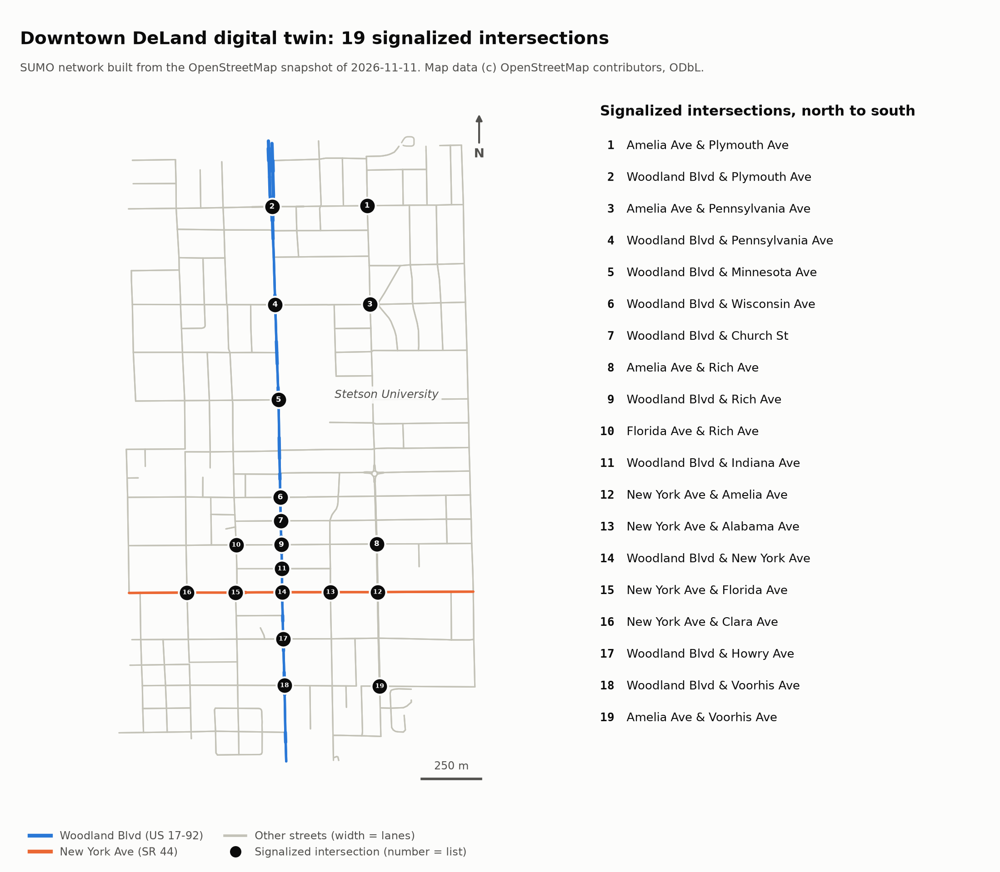

# OmniFlow Real

AI traffic signal control for downtown DeLand, Florida: a SUMO digital twin of
the Woodland Blvd (US 17-92) corridor, with multi-agent reinforcement learning
compared fairly against fixed-time and actuated signal control.

> **Status: milestones M0 and M1 are complete** (design and environment; the
> road network). There are no traffic results yet. Nothing in this repository
> is a claim about real traffic in DeLand so far. The results table, figures
> and exact reproduction commands arrive with milestones M3 to M7.

## What this project will do

1. Build the downtown DeLand road network from OpenStreetMap.
2. Calibrate simulated traffic against real counts (FDOT data and counts from
   intersection videos).
3. Run three signal controllers on identical traffic: fixed-time, actuated,
   and reinforcement learning (PPO, one shared policy for all intersections).
4. Report average delay, queue length, throughput and CO2, as mean and 95%
   confidence interval over several random seeds, including stress scenarios
   (incident, large event, emergency vehicle).

The full plan, including how the comparison is kept fair and what can go
wrong, is in [`DESIGN.md`](DESIGN.md).

## The digital twin network (M1)



The network is built from a frozen OpenStreetMap snapshot (in `data/osm/`)
by one script. Rebuilding it gives a byte-identical file:

```bash
uv run python scripts/m1_build_network.py
```

What the script produces, all in `results/m1_network/`:

- `summary.md`: network size, speed limits, build warnings, every signal, and
  the comparison with FDOT's list of signals on Woodland Blvd;
- `signals.csv`: one row per signalized intersection;
- `field_checklist.md`: a printable list for checking the network on the
  street;
- `network_map.png`: the map above.

To explore the network in the SUMO window:

```bash
uv run sumo-gui -n network/deland.net.xml
```

## Quickstart

You need [uv](https://docs.astral.sh/uv/getting-started/installation/), a
Python package manager. It installs the right Python version and every
dependency for you, including the SUMO traffic simulator.

```bash
git clone https://github.com/ShehabHani7127/omniflow-real.git
cd omniflow-real
uv sync
```

Check that everything works:

```bash
uv run pytest
```

```bash
uv run python scripts/m0_smoke_test.py
```

The smoke test simulates one toy intersection and should end with:

```
Checks:
  [PASS] vehicles entered the network and all of them arrived
  [PASS] same seed gives exactly the same result (reproducible)
  [PASS] a different seed gives different traffic
  [PASS] libsumo and traci give exactly the same result
  [PASS] holding north-south green strands east-west traffic

ALL CHECKS PASSED.
```

It then prints a `sumo-gui` command that opens the toy intersection in the
SUMO window, so you can watch it.

### Supported computers

The simulator is installed from the `eclipse-sumo` package, version 1.28.0. It
is published for Windows (64-bit), Linux (x86-64 and ARM), and macOS on Apple
Silicon (macOS 15 or newer). There is no package for Intel Macs.

## Milestones

| # | Milestone | Status |
|---|-----------|--------|
| M0 | Design, environment, linting, tests, first simulation | done |
| M1 | Digital twin network from OpenStreetMap | done |
| M2 | Traffic demand and calibration against counts | not started |
| M3 | Baselines (fixed-time, actuated) and metrics | not started |
| M4 | Multi-agent reinforcement learning | not started |
| M5 | Stress tests | not started |
| M6 | Vehicle counting from video | not started |
| M7 | Report, dashboard export, polish | not started |

## Repository layout

```
DESIGN.md       the plan: architecture, metrics, experiment protocol, risks
LEARNING.md     plain-language notes on what was built and why, per milestone
CLAUDE.md       project memory for AI-assisted sessions (goal, decisions, status)
data/           real-world inputs: map extract, traffic counts (videos are not committed)
network/        the SUMO road network and its build inputs
results/        generated tables and figures
scripts/        one entry point per milestone
src/omniflow/   the Python package, one sub-package per pipeline stage
tests/          automated tests
```

## Development

```bash
uv run ruff check .
```

```bash
uv run ruff format .
```

```bash
uv run pytest
```

A GitHub Actions workflow
([`.github/workflows/ci.yml`](.github/workflows/ci.yml)) runs the same checks
on every push, on Linux, Windows and macOS.

Later milestones need two optional dependency sets:

```bash
uv sync --extra rl
```

```bash
uv sync --extra vision
```

## Licences and credits

- This repository's code: MIT, see [`LICENSE`](LICENSE).
- [Eclipse SUMO](https://eclipse.dev/sumo/), the traffic simulator: EPL-2.0.
- The optional vision dependency `ultralytics` is AGPL-3.0. It is only
  installed with `--extra vision`.
- Map data: © OpenStreetMap contributors, available under the
  [Open Database License](https://opendatacommons.org/licenses/odbl/). See
  <https://www.openstreetmap.org/copyright>.
